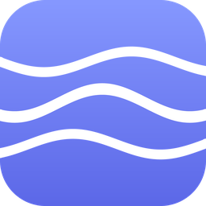

<div align="center">



# Flow

**All-in-one, local-first productivity for the desktop.**
Todos · habits · goals · focus timers · grades · notes · flashcards · sound studio · 124 tools


[](https://github.com/opngo/flow/actions/workflows/release.yml)
[](https://github.com/opngo/flow/actions/workflows/pages.yml)
[](https://github.com/opngo/flow/actions/workflows/codeql.yml)
[](LICENSE)

[Website](https://opngo.github.io/flow/) · [Download](https://github.com/opngo/flow/releases/latest) · [Docs](docs/) · [Report a bug](https://github.com/opngo/flow/issues/new/choose)

</div>

---

Flow replaces the to-do app, the habit tracker, the pomodoro timer, the grade
spreadsheet, the notes app and the ambient noise tab with one desktop program
that reads from a single local database. No account, no subscription, no
telemetry, no network requests at runtime.

| | |
|---|---|
| **Local-first** | One JSON database in your user-data folder, versioned migrations, rolling backups. Export and import it any time. |
| **Offline forever** | The app makes zero network calls. The landing page does too. |
| **Clock-derived timers** | Timers store start and end timestamps and recompute the remainder, so sleep, throttling and restarts cannot make them drift. |
| **Type-safe** | Zod schemas for every entity, strict TypeScript, 41 tests in CI, CodeQL and dependency review on every pull request. |
| **Fault-tolerant** | Per-collection recovery keeps a corrupt record from costing you the database; a route-level error boundary keeps the app alive. |

## Download

Installers are attached to every [release](https://github.com/opngo/flow/releases/latest) and built by the
[`release.yml`](.github/workflows/release.yml) workflow on Windows, macOS and Linux runners.

| Platform | File |
|---|---|
| Windows 10/11 (x64, ARM64) | `Flow-<version>-win-<arch>.exe` (NSIS, per-user, no admin) |
| Windows portable | `Flow-<version>-portable.exe` |
| macOS (Apple silicon, Intel) | `Flow-<version>-mac-<arch>.dmg` |
| Linux | `Flow-<version>-linux-x86_64.AppImage`, `.deb`, `.tar.gz` |

Verify a download against `SHA256SUMS.txt` from the same release:

```sh
sha256sum -c SHA256SUMS.txt --ignore-missing
```

Builds are unsigned unless a release says otherwise, so Windows SmartScreen shows
"Windows protected your PC" once (More info, Run anyway) and macOS needs a
right-click then Open. Prefer to trust nothing you did not compile? It takes two
minutes: see [Build from source](#build-from-source).

## Build from source

Requirements: Node 20 or newer, npm 10 or newer, and a C toolchain only if you
package for your own OS.

```sh
git clone https://github.com/opngo/flow.git
cd flow
npm ci
npm run dev          # http://localhost:5173 — the whole app, browser mode
npm run electron:dev # the same app inside the Electron shell
```

| Script | Does |
|---|---|
| `npm run dev` | Vite dev server on `0.0.0.0:5173` |
| `npm run electron:dev` | Vite plus the Electron main process |
| `npm run build` | `tsc --noEmit` then a production bundle into `dist/` |
| `npm test` | Vitest suite (41 tests) |
| `npm run typecheck` | Strict TypeScript, no emit |
| `npm run dist:win` / `dist:mac` / `dist:linux` | Build and package for one platform into `release/` |
| `npm run verify:workflows` | Parse and lint every file in `.github/workflows` |
| `npm run landing:serve` | Preview the GitHub Pages site at `localhost:5180` |
| `npm run landing:stamp` | Resolve version and download links in `landing/index.html` |
| `npm run icon` | Regenerate the app icon set from `build/make-icon.py` |

## Repository layout

```
.github/
  workflows/            ci · release · pages · nightly · codeql · dependency-review · lighthouse · stale
  ISSUE_TEMPLATE/       bug report · feature request · config
  CODEOWNERS · dependabot.yml · PULL_REQUEST_TEMPLATE.md · FUNDING.yml
build/                  icon sources and generated icon set, macOS entitlements
docs/                   ARCHITECTURE · RELEASING · WORKFLOWS · PROJECT_STATE
electron/               main.cjs · preload.cjs · dev.mjs
landing/                the GitHub Pages site (one self-contained HTML file)
scripts/                validate-workflows · release-notes · stamp-landing · serve-landing
src/                    the renderer: pages, components, store, lib, audio
tests/                  Vitest suites
```

## Workflows

| Workflow | Trigger | What it does |
|---|---|---|
| [`ci.yml`](.github/workflows/ci.yml) | push, pull request | Typecheck, tests, build, artifact upload; validates workflow files; enforces the no-emoji and no-placeholder rules; audits production dependencies |
| [`release.yml`](.github/workflows/release.yml) | tag `v*.*.*` or manual | Preflight gates, then packages on Windows, macOS and Linux, generates notes, publishes the release with `SHA256SUMS.txt` |
| [`pages.yml`](.github/workflows/pages.yml) | push to `main` touching `landing/**` | Stamps the latest version into the landing page, checks it is self-contained, deploys to GitHub Pages |
| [`nightly.yml`](.github/workflows/nightly.yml) | daily at 03:00 UTC | Packages `main` and moves a rolling pre-release tag so packaging never rots between releases |
| [`codeql.yml`](.github/workflows/codeql.yml) | push, pull request, weekly | Static analysis of the JavaScript and TypeScript sources |
| [`dependency-review.yml`](.github/workflows/dependency-review.yml) | pull request | Blocks new high-severity or copyleft dependencies |
| [`lighthouse.yml`](.github/workflows/lighthouse.yml) | pull request touching `landing/**` | Audits the landing page against the budget in `lighthouse-budget.json` |
| [`stale.yml`](.github/workflows/stale.yml) | weekly | Marks and eventually closes inactive issues and pull requests |

Details, required secrets and the exact release procedure are in
[`docs/WORKFLOWS.md`](docs/WORKFLOWS.md) and [`docs/RELEASING.md`](docs/RELEASING.md).
The one-time repository setup — Pages, branch protection, Discussions, publishing
the first tag — is in [`docs/SETUP_GITHUB.md`](docs/SETUP_GITHUB.md).

## Architecture in one screen

```
main.cjs  ── owns the window, tray, notifications, global shortcuts, scheduler
   │  (preload exposes a narrow, typed bridge: window.flow)
   ▼
repo.ts   ── persistence: Electron IPC when packaged, localStorage otherwise,
   │         versioned migrations, per-collection recovery, rolling backups
   ▼
store.ts  ── the only writer: todos, habits, goals, timers, grades, notes, decks,
   │         sessions, reminders, settings — all validated by Zod
   ▼
pages/    ── 16 routes plus 76 tool renderers, all lazy-loaded
```

Timers never count down: they store `startedAt` and `endsAt`, and the UI
recomputes the remainder from the wall clock. The main process holds the same
authority for reminders, so a closed window does not lose a notification.

More detail, including the design rules the UI is held to (no borders, no
outlines, tint-and-glow focus, Lucide only, Headless UI for every control), is in
[`docs/ARCHITECTURE.md`](docs/ARCHITECTURE.md).

## Atmosphere and appearance

Appearance is a first-class feature, and every part of it is opt-in.

- **Backdrop effects** — Settings → Appearance → Backdrop. Eight atmospheres behind
  the interface: CRT wrap (scanlines, aperture grille, vignette, rolling band),
  ordered dither, dot grid, aurora, hyperspeed, silk and film grain. Each has
  intensity, speed and, where it applies, pixel size. The preview runs the real
  renderer, so what you see is what you get. Effects pause when the window is
  hidden, cap themselves at 24,000 buffer cells and 30 frames per second, and
  render a single still frame when reduced motion is on.
- **Immersive clock** — the titlebar button, the Focus page, the palette, or
  `Ctrl/Cmd+Shift+Enter`. Three clocks share one surface: Pomodoro, a plain
  countdown with a duration picker, and a stopwatch with hundredths and laps.
  `1` `2` `3` switch between them, `Space` starts or pauses, `L` laps, `R` resets,
  `F` logs, `Esc` exits. While one runs, the buttons and footer fade out and leave
  the digits and the progress line on their own; move the pointer to bring them
  back.
- **Corner rounding** — one slider from 0 to 28 px that every surface follows, plus
  a sharp mode that flattens everything, pills included.
- **Custom controls** — every slider in the app is drawn from scratch with
  keyboard support and tick marks, because the native range control cannot be
  themed to match a surface it insists on outlining.
- **Demo data** — Settings → Data. The example records are tagged and merged
  additively, so loading them beside your own work leaves your theme, backdrop,
  corners, sidebar, tools, shortcuts, running timer and tutorial state exactly as
  they were. Removing the demo set strips only the tagged records.

## Keyboard

| Keys | Action |
|---|---|
| `Ctrl/Cmd K` | Command palette: pages, tools, records, commands |
| `Ctrl/Cmd Shift Space` | Quick capture from anywhere |
| `Ctrl/Cmd Shift F` | Mini mode |
| `Ctrl/Cmd Shift Enter` | Immersive full-screen timer |
| `Ctrl/Cmd Shift P` | Start or pause the focus timer |
| `Ctrl/Cmd Z` / `Shift` | Undo / redo |
| `?` | Shortcut sheet |
| `Esc` | Close overlay, leave focus mode |
| Todos list | `j` `k` move · `Space` complete · `e` edit · `d` delete · `t` today · `p` priority · `/` search |
| Immersive clock | `Space` start or pause · `1` `2` `3` pomodoro / timer / stopwatch · `L` lap · `R` reset · `F` log · `↑` `↓` five minutes · `Esc` exit |

## The landing page

[`landing/index.html`](landing/index.html) is a single self-contained file: inline
CSS, inline SVG and canvas, no fonts from a CDN, no scripts from anywhere but
itself. That keeps the marketing page honest about the product's own promise, and
it means it works from a Pages subpath, from `file://`, and inside a sandboxed
preview frame.

The page is built around three pieces, all of them drawn in code rather than
shipped as images:

- **A pixel hero scene** rendered on a 240 × 150 canvas: a dithered five-tone sky,
  a desk, a monitor showing the app, drifting dust and steam. Three rendering
  modes (pixel, CRT with scanlines and a rolling band, clean with smoothing), a
  parallax offset that follows the pointer, and an honest readout under it.
- **A horizontal panorama** of six product panels. Vertical scroll pins the section
  and translates the track sideways, with a progress bar and a panel counter; below
  900 px it degrades to a native swipe strip with no scroll hijacking.
- **A parallax wordmark and a page-wide scanline toggle** (`P`), plus platform-aware
  download buttons and keyboard-operable tabs.

It is committed with real version numbers so it renders correctly when opened from
disk; the stamp step moves those numbers forward on every release.

```sh
npm run landing:serve     # http://localhost:5180
npm run landing:stamp     # resolve __FLOW_VERSION__ and download links
```

`pages.yml` runs the stamp step on every deploy, so the page always advertises
the newest published release.

## Contributing

Issues and pull requests are welcome. Read [`CONTRIBUTING.md`](CONTRIBUTING.md)
first: it covers the design rules that are not negotiable, how to run the checks
locally, and what gets a pull request turned down. Security reports go through
[`SECURITY.md`](SECURITY.md), never a public issue.

## License

[MIT](LICENSE) © 2026 opngo. Use it, fork it, ship it.
